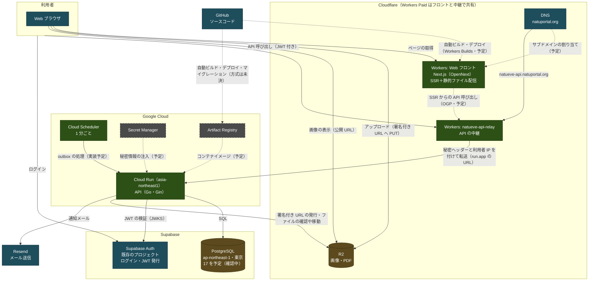

# デプロイ構成（全体）

なちゅいべ全体の本番デプロイ構成をまとめる（2026-10 時点）。
各リポジトリの設定値・月額試算・未決事項は、それぞれの `docs/Deployment.md` を参照する。

| 対象 | デプロイ先 | 詳細 |
|---|---|---|
| バックエンド（API） | Google Cloud Run（東京）＋Cloud Scheduler | [NatuIve_API: docs/Deployment.md](https://github.com/GokujyouKaisennDonnburi/NatuIve_API/blob/main/docs/Deployment.md)・ADR-0032 |
| DB | Supabase の PostgreSQL（東京） | 同上 |
| 認証 | Supabase Auth（既存のプロジェクト） | 同上 |
| Web フロントエンド | Cloudflare Workers（Paid）＋OpenNext | [NatuIve_Web_Frontend: docs/Deployment.md](https://github.com/GokujyouKaisennDonnburi/NatuIve_Web_Frontend/blob/main/docs/Deployment.md)・ADR-0001 |

## 構成図

### 凡例

| 表記 | 意味 |
|---|---|
| 緑のノード | 今回決定した本番の実行基盤 |
| 青のノード | 既存のサービス・利用者 |
| 灰色・破線のノード | 使う予定のサービス（未導入） |
| 茶色のノード | データの保存先（新規・既存を問わない） |
| 実線の矢印 | 方式が決まっている通信（実装予定のものを含む） |
| 破線の矢印 | 未導入のサービスとの通信、または方式が未決の通信 |

## 主な流れ

- **ページの表示**: ブラウザは Cloudflare Workers からページを受け取る。Next.js が SSR で返し、JS・CSS などの静的ファイルはそのまま配信される。
- **データの取得・投稿**: ブラウザは、Cloud Run の API を JWT 付きで直接呼ぶ。API は Supabase の PostgreSQL を読み書きする。
- **ログイン**: ブラウザは Supabase Auth でログインし、JWT を受け取る。API は Supabase Auth の JWKS で JWT を検証する。
- **画像・PDF**: ブラウザは API から署名付き URL を受け取り（`POST /api/v1/uploads/presign`）、その URL へ直接 PUT してアップロードする。
  表示は R2 の公開 URL から直接行う。API は R2 上のファイルの確認・コピー・削除も行う。
- **通知メール**: API は送信予約（outbox）を DB に書く。Cloud Scheduler が 1 分ごとに API を呼んで送信処理を起動し（実装予定）、Resend で送る。

